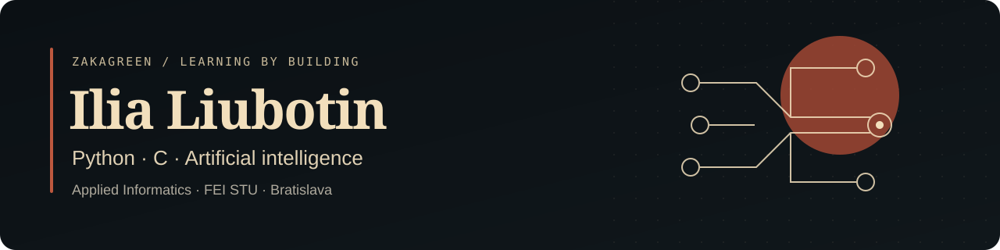

  

  <a href="mailto:ilushkalubotin@gmail.com">Email</a> ·
  <a href="#selected-work">Selected work</a> ·
  <a href="#erasmus-internship">Erasmus+ internship</a>

I'm **Ilia**, an Applied Informatics bachelor's student at **FEI, Slovak University of Technology in Bratislava**. My main interests are Python, C and artificial intelligence. I learn through university assignments, small experiments and practical development work.

**Open to internships and part-time IT opportunities in Slovakia and the EU**, especially software development, Python, data and automation.

### Selected work

| Project | What to explore |
| --- | --- |
| **[Machine learning fundamentals](https://github.com/ZakaGreen/AI_studying)** · Python | Perceptron and ADALINE learning exercises, Iris classification plots and a simple linear approximation experiment. |
| **[Programming coursework](https://github.com/ZakaGreen/study)** · C / C++ / Java / R | Start with the [C army simulation](https://github.com/ZakaGreen/study/tree/main/C_studying/Programming_2/zadanie4), then explore object-oriented programming and statistics exercises. |
| **[Web technologies coursework](https://github.com/ZakaGreen/webte1)** · JavaScript | A restaurant-menu viewer with HTML parsing and local caching, plus a personal website and smaller exercises. |

These repositories contain educational work and learning experiments. Each project README explains its scope and how to get started.

### Erasmus+ internship

**Software Development Intern · Erciyes University**  
Kayseri, Türkiye · June–August 2026

I worked as part of a team extending **UniMetrik**, an existing university quiz and examination platform.

- Contributed to academic data management and learning-outcome features.
- Worked on backend, API, database and frontend changes through development and testing tasks.
- Gained practical experience with **Python, Django REST Framework, PostgreSQL, React and TypeScript**.
- Learned to work within an existing codebase and coordinate changes with other team members.

This was a team project; the repository is private. My public coursework above provides examples of my learning and programming practice.

### Currently exploring

My bachelor's thesis focuses on **predicting the effect of public news and likely future events on stock returns using language models**. It is at an early research stage: the public [thesis repository](https://github.com/ZakaGreen/bakalarska-praca) currently contains the LaTeX writing setup, with experiments still to come.

I am particularly interested in separating the probability of an event from the market reaction if it happens.

### A little activity, a little play

<picture>
  <source media="(prefers-color-scheme: dark)" srcset="https://raw.githubusercontent.com/ZakaGreen/ZakaGreen/output/github-snake-dark.svg" />
  <source media="(prefers-color-scheme: light)" srcset="https://raw.githubusercontent.com/ZakaGreen/ZakaGreen/output/github-snake.svg" />
  
</picture>

Generated from my contribution calendar with [snk](https://github.com/Platane/snk). Updated daily.
