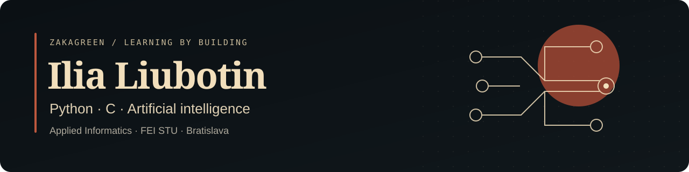

[English](README.md) · [Slovenčina](README.sk.md) · [Русский](README.ru.md)

  

Som **Ilia**, študent aplikovanej informatiky na **FEI STU v Bratislave**. Baví ma vytvárať neurónové siete a rozoberať matematiku, na ktorej fungujú. Práve pochopenie toho, ako sa algoritmus učí, ma na AI veľmi priťahuje.

**Hľadám stáž alebo prácu na čiastočný úväzok v IT na Slovensku alebo v EÚ.** Najviac ma zaujíma AI/ML, ale aj Python, dáta, automatizácia a vývoj softvéru.

[Napíšte mi](mailto:ilushkalubotin@gmail.com) · [LinkedIn](https://www.linkedin.com/in/ilia-liubotin-89512144b/) · [GitLab](https://gitlab.com/ilushkalubotin)

## Čomu som venoval čas, aby som tomu porozumel

### Ako fungujú učiace sa algoritmy

V [AI_studying](https://github.com/ZakaGreen/AI_studying) som si prešiel matematiku perceptrónu, ADALINE a lineárnej aproximácie. Malé experimenty mi pomohli prepojiť výpočty s tým, čo programy skutočne robia.

**Obzvlášť ma zaujali [genetické algoritmy](https://github.com/ZakaGreen/evolutionary-algorithms).** Študoval som jednotlivé operátory, zostavoval algoritmy pre školské zadania a veľa času venoval ladeniu prvých experimentov. Takto vyzerá moje zadanie na hľadanie trasy v praxi:

Jeden zaznamenaný beh školského zadania: populácia 100 jedincov a 500 generácií. Repozitár obsahuje pôvodný kód a postup reprodukcie.

Absolvoval som aj zadania v PyTorchi s MLP a konvolučnými sieťami. Pracoval som so šablónami a pritom sa učil rozumieť architektúram a procesu trénovania.

### Na čo vlastne ukazujú smerníky

Smerníky a štruktúry v C mi spočiatku nedávali jasný obraz. Keď som si naštudoval fungovanie pamäte, ľahšie som si predstavil, čo kód robí, a zadania som nakoniec vypracoval sám. Jedným z príkladov je [simulácia armád v C](https://github.com/ZakaGreen/study/tree/main/C_studying/Programming_2/zadanie4).

Operačné systémy skúmam aj cez **[laboratórne úlohy s xv6](https://github.com/ZakaGreen/xv6-labs-2026)**: procesy, systémové volania, tabuľky stránok a pasce. Zadania spravujem na [GitLabe](https://gitlab.com/ilushkalubotin/xv6-xliubotin-2026), tu na GitHube je ich kópia.

## Leto v tíme vývojárov

**Erasmus+ · Erciyes University · Kayseri, Turecko · jún – august 2026**

V tíme som pracoval na rozšírení **UniMetrik**, existujúcej univerzitnej platformy na kvízy a skúšky. Prispieval som k správe akademických údajov a funkciám pre výsledky vzdelávania prostredníctvom vývoja a testovania backendu, API, databázy a frontendu.

Získal som praktické skúsenosti s Pythonom, Django REST Framework, PostgreSQL, Reactom a TypeScriptom aj s koordináciou zmien v existujúcom projekte.

## Otázka pre moju bakalársku prácu

**Ako by sme mohli odhadnúť reakciu akcie na udalosť, ktorá sa ešte nestala?**

Moja [bakalárska práca](https://github.com/ZakaGreen/bakalarska-praca) skúma verejné správy, pravdepodobné budúce udalosti a jazykové modely. Zaujíma ma najmä rozdiel medzi pravdepodobnosťou udalosti a reakciou trhu, ak nastane. Práca je v počiatočnej fáze výskumu.

## Ďalšie repozitáre

- [Programátorské zadania](https://github.com/ZakaGreen/study): C, C++, OOP v Jave a štatistika v R.
- [Webové technológie](https://github.com/ZakaGreen/webte1): školské cvičenia vrátane prehliadača jedálnych lístkov s parsovaním HTML a lokálnou vyrovnávacou pamäťou.

<picture>
  <source media="(prefers-color-scheme: dark)" srcset="https://raw.githubusercontent.com/ZakaGreen/ZakaGreen/output/github-snake-dark.svg" />
  <source media="(prefers-color-scheme: light)" srcset="https://raw.githubusercontent.com/ZakaGreen/ZakaGreen/output/github-snake.svg" />
  
</picture>

Malá prestávka medzi commitmi. Animácia od [snk](https://github.com/Platane/snk), aktualizovaná denne.
